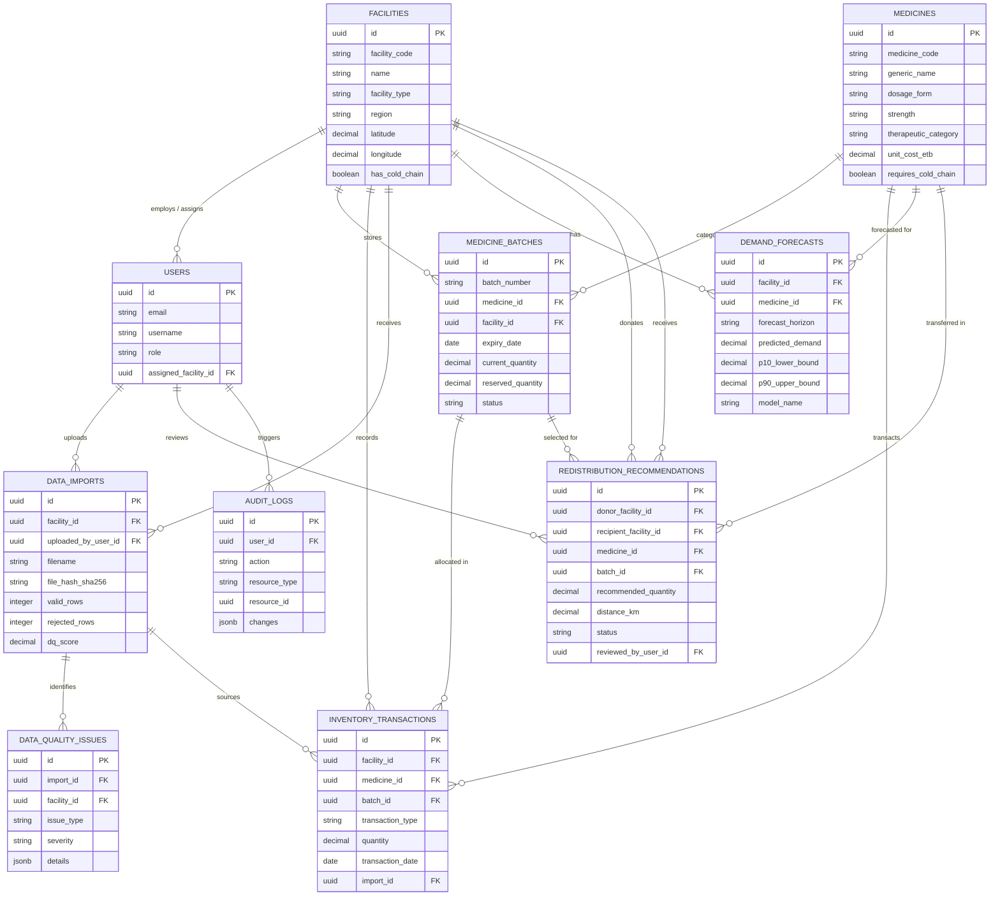

# Entity-Relationship (ER) Diagram

---

## 1. Visual Entity Relationships

The following Mermaid ER diagram illustrates the relational models, cardinalities, and foreign key dependencies within PharmaIntelligence AI.

---

## 2. Cardinality and Integrity Rules

1. **One-to-Many (`1:N`) Facilities to Batches:** A health facility holds zero or more inventory batches. Each batch is physically situated at exactly one facility at any given point in time.
2. **One-to-Many (`1:N`) Medicines to Batches:** A master catalog medicine record links to multiple physical batches distinguished by batch numbers and expiration dates.
3. **Many-to-One (`N:1`) Transactions to Batches:** Individual inventory transactions may link directly to a specific batch (crucial for FEFO auditability), or be recorded at the general medicine level if legacy paper records lack batch granularity.
4. **Many-to-Many (`M:N`) Facilities via Redistribution:** Lateral transfer recommendations create a directional relationship between two distinct facilities (a `donor_facility` and a `recipient_facility`). Database constraints enforce that `donor_facility_id != recipient_facility_id`.
5. **Cascading and Soft Deletion:** Critical master entities (facilities, medicines) use soft-delete flags (`is_active = FALSE`) to prevent cascading deletions of historical transaction ledgers and audit records.
