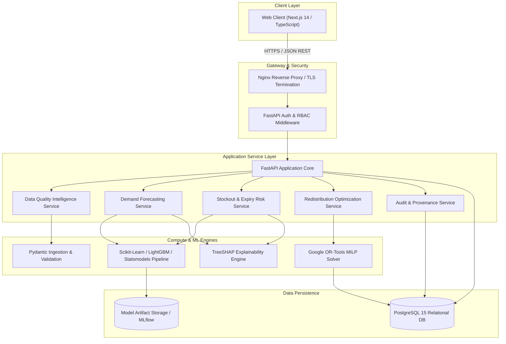

# System Architecture Specification

---

## 1. Architectural Philosophy and Design Goals

PharmaIntelligence AI is architected according to principles of **clean architecture, strict modularity, high testability, and operational resilience**:
1. **Decoupled Monolith with Microservice Readiness:** Initiates as a modular monolith to minimize operational complexity in low-resource deployments, while maintaining clean service boundaries that can be split into standalone containers (e.g., dedicated optimization workers) as load demands.
2. **Strict Separation of Data States:** Absolute separation between:
   - *Source Observations:* Original, unedited imported records.
   - *Engineered Features:* Transformed, de-censored analytical representations.
   - *Model Predictions & Recommendations:* Probabilistic outputs, forecasts, and transfer proposals.
   - *Operational Approvals:* Human review logs and physical execution status.
3. **Fail-Safe Asynchronous Execution:** Heavy numerical tasks (training models, MILP solvers) run off the main HTTP request-response thread, ensuring the web UI remains responsive.

---

## 2. High-Level System Architecture

---

## 3. Layered Architectural Decomposition

### 3.1 Presentation Layer (Frontend)
- **Framework:** Next.js 14 with React Server Components (RSC) and Client Components where interactivity is required.
- **Styling & UI Kit:** Tailwind CSS paired with accessible shadcn/ui components (Radix UI primitives).
- **State Management & Data Fetching:** TanStack React Query (React Query v5) for robust server-state caching, optimistic updates, and background refetching.
- **Visualizations:** Recharts and Tremor for time-series forecast graphs, prediction intervals, and SHAP feature importance charts.

### 3.2 Application & API Layer (Backend)
- **Framework:** Python 3.11+ using FastAPI, leveraging modern asynchronous request handling (`async`/`await`).
- **Data Validation & Serialization:** Pydantic v2 for high-performance schema serialization and strict request validation.
- **Security:** OAuth2 with Password Bearer flow, JWT tokens (HMAC-SHA256), and Argon2id password hashing.
- **Architecture Pattern:** Clean Repository-Service Pattern:
  - *Routers (`app/api/v1`):* Handle HTTP requests, query parameters, and status codes.
  - *Services (`app/services`):* Encapsulate business logic, calculations, and coordination.
  - *Repositories (`app/repositories`):* Abstract database queries using SQLAlchemy 2.0 ORM.
  - *Schemas (`app/schemas`):* Define Pydantic request and response models.

### 3.3 Computational & Analytical Engines
- **Data Quality Intelligence:** Ingests raw CSV/Excel, runs structural schema validation, computes stock balance reconciliation equations, and scores record integrity.
- **Forecasting Pipeline:** Encapsulates statsmodels, Croston estimators, and LightGBM regressors with stockout de-censoring transformations.
- **Risk Evaluation Service:** Evaluates Days-of-Stock heuristics and runs supervised tree classifiers for multi-horizon risk scoring.
- **Redistribution Optimization:** Formulates linear/integer constraints and invokes the Google OR-Tools CBC/SCIP solver to find optimal lateral transfer configurations.
- **Explainability Engine:** Generates SHAP local feature attributions and transforms raw SHAP values into user-friendly diagnostic summaries.

### 3.4 Persistence Layer (Database & Storage)
- **Database:** PostgreSQL 15+ configured with connection pooling (`asyncpg`).
- **Migrations:** Alembic for automated, reversible database schema evolution.
- **Model Registry:** MLflow tracking server and disk artifact store for serialized model binaries (`.joblib` / `.onnx`) and experiment metadata.
- **File Staging:** Secure local or S3-compatible object storage for uploaded inventory files and exported PDF reports.

---

## 4. Cross-Cutting Architectural Concerns

### 4.1 Scalability and Resource Efficiency
- In public health facilities with modest hardware, the backend and frontend can run on a single dual-core 4GB RAM workstation using Docker Compose.
- In regional or central deployments, compute-intensive optimization and training workloads can be delegated to dedicated Celery/Redis worker nodes without altering core API contracts.

### 4.2 Security and Network Resilience
- Reverse proxy (Nginx) enforces rate limiting, SSL/TLS termination, and security headers (HSTS, CSP, X-Frame-Options).
- Backend enforces strict CORS policies allowing only verified frontend origins.
- Application operates effectively under intermittent connectivity: users can stage uploads locally, which are processed sequentially once network connection resumes.
