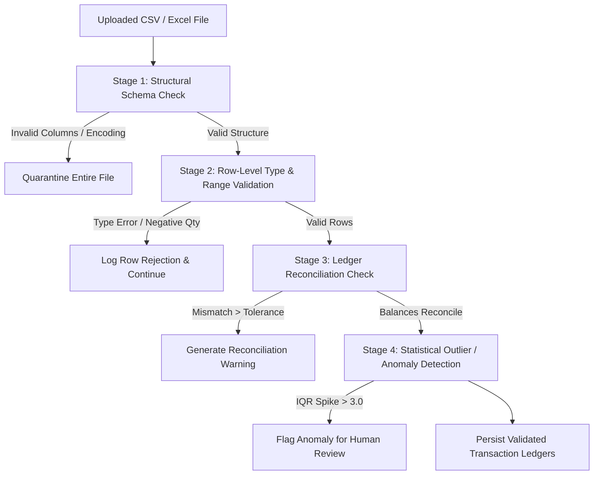

# Data Cleaning Rules and Validation Protocols

---

## 1. Principles of Data Sanitation

Data collected from health facility paper bin cards, Excel worksheets, and eLMIS extracts often exhibit human transcription errors, broken formulas, and missing values.

PharmaIntelligence AI enforces three fundamental principles for data sanitation:
1. **Never Overwrite Source Data:** Raw ingested records are persisted immutably. Cleaned or imputed representations are generated in distinct transformed analytical views.
2. **Explicit Rule Attribution:** Every rejected row or flagged anomaly must be logged with a deterministic reason code and human-readable explanation.
3. **Fail-Closed on Critical Invariants:** Core relational keys (facility code, medicine code, transaction date) must strictly conform to schema requirements; corrupt rows are quarantined rather than guessed.

---

## 2. Ingestion Validation Pipeline

---

## 3. Explicit Cleaning and Transformation Rules

### Rule Set A: Structural & DataType Enforcement
- **RULE-A01 (Encoding & Delimiters):** File must be UTF-8 encoded. Permitted delimiters: comma (`,`), semicolon (`;`), tab (`\t`).
- **RULE-A02 (Mandatory Columns):** Ingested files must contain required headers defined in the Data Dictionary. Missing headers trigger immediate file rejection.
- **RULE-A03 (Date Normalization):** Dates must conform to ISO-8601 (`YYYY-MM-DD`). Legacy formats (`DD/MM/YYYY`, `MM-DD-YYYY`) are parsed deterministically; ambiguous date strings are flagged.
- **RULE-A04 (Non-Negativity):** Transaction quantities and stock balances must be non-negative ($\ge 0$). Inward receipts or issues with negative numbers are converted to explicit adjustment transactions or rejected.

### Rule Set B: Inventory Ledger Reconciliation
- **RULE-B01 (Stock Balance Equation):** For inventory snapshot files containing opening stock, receipts, issues, adjustments, and closing stock:
  $$\text{Expected Closing} = \text{Opening} + \text{Receipts} - \text{Issues} + \text{Adjustments}$$
  If $|\text{Actual Closing} - \text{Expected Closing}| > 0.01$, create an entry in `data_quality_issues` with severity `WARNING`.
- **RULE-B02 (Chronological Consistency):** For any batch record, $\text{Manufacture Date} \le \text{Receipt Date} < \text{Expiry Date}$. Batches with $\text{Expiry Date} \le \text{Manufacture Date}$ are rejected as logically impossible.

### Rule Set C: Demand De-censoring & Missingness Handling
- **RULE-C01 (Stockout-Censored Demand Adjustment):**
  When calculating monthly consumption $C_{\text{obs}}$ for a medicine experiencing $S$ stockout days in a month with $T$ total operational days:
  $$\text{In-Stock Ratio } R = \frac{T - S}{T}$$
  - If $R \ge 0.90$ (minor stockout $< 3$ days): No adjustment ($C_{\text{adj}} = C_{\text{obs}}$).
  - If $0.10 \le R < 0.90$: Adjust consumption to estimated full-month potential:
    $$C_{\text{adj}} = \frac{C_{\text{obs}}}{R}$$
  - If $R < 0.10$ (severe stockout $> 90\%$ of month): Mark month as **Unreliable / Censored**. Impute using rolling median of in-stock months or median of neighboring facility consumption.
- **RULE-C02 (Intermittent Zero Imputation):**
  Distinguish between **True Zero Consumption** (stock was available, but no patients required the medicine) and **Censored Zero** (stock was zero).
  - If $\text{Closing Stock} > 0$ and $\text{Issues} = 0 \rightarrow$ Genuine Zero.
  - If $\text{Closing Stock} = 0$ and $\text{Issues} = 0 \rightarrow$ Stockout-Censored Zero.

### Rule Set D: Outlier and Anomaly Detection
- **RULE-D01 (Statistical Consumption Outliers):**
  Compute the Interquartile Range ($IQR = Q_3 - Q_1$) of monthly issues per medicine-facility pair over a 12-month rolling window.
  $$\text{Upper Threshold} = Q_3 + 3.0 \times IQR$$
  Values exceeding this threshold are flagged as `ANOMALOUS_SPIKE` for pharmacist verification (may represent an unrecorded outbreak, mass vaccination campaign, or bulk transfer out).
