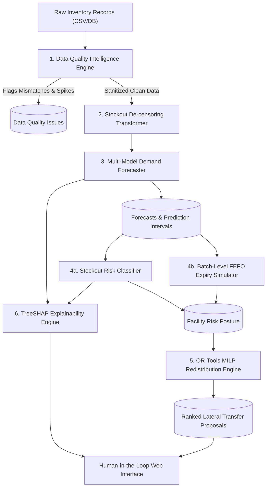

# Artificial Intelligence System Design Specification

---

## 1. AI System Architectural Philosophy

PharmaIntelligence AI rejects the dogma of applying opaque deep learning to every task. In healthcare logistics within low-resource environments, the optimal AI system balances **empirical accuracy, computational efficiency, explainability, and robustness to noisy data**.

```
┌────────────────────────────────────────────────────────────────────────┐
│                   PHARMAINTELLIGENCE AI SUBSYSTEMS                     │
├─────────────────┬──────────────────┬─────────────────┬─────────────────┤
│ Pillar 1: DQI   │ Pillar 2: Demand │ Pillar 3: Dual  │ Pillar 4: Lateral│
│ Data Quality    │ Forecasting      │ Risk Evaluation │ Redistribution  │
│ (Rule + Anomaly)│ (Croston, GBDT)  │ (Stockout/FEFO) │ (MILP Solver)   │
└─────────────────┴──────────────────┴─────────────────┴─────────────────┘
                                   │
                                   ▼
┌────────────────────────────────────────────────────────────────────────┐
│               PILLAR 5: EXPLAINABILITY & HUMAN OVERSIGHT               │
│               (TreeSHAP + Uncertainty Intervals + Audit)               │
└────────────────────────────────────────────────────────────────────────┘
```

---

## 2. Component Pipeline Architecture

The analytical pipeline processes inventory records through five sequential, loosely coupled stages:



---

## 3. High-Level Subsystem Specifications

### 3.1 Subsystem 1: Data Quality Intelligence (DQI)
- **Role:** Guards the downstream predictive models against data corruption.
- **Approach:** Composite rule-based checking for deterministic balance equations + unsupervised statistical anomaly detection (Isolation Forest) for unannounced consumption deviations.

### 3.2 Subsystem 2: Censoring-Aware Demand Forecaster
- **Role:** Predicts future monthly/weekly consumption per medicine-facility pair.
- **Approach:** Syntetos-Boylan demand categorization $\rightarrow$ dynamic dispatch to Croston / TSB for intermittent items, and LightGBM / XGBoost with lag features for smooth/seasonal items. Incorporates in-stock day de-censoring.

### 3.3 Subsystem 3: Stockout Risk Intelligence
- **Role:** Classifies probability of stock depletion prior to next replenishment.
- **Approach:** Supervised gradient boosting classifier evaluating Days of Stock Remaining (DSR), open order lead times, and demand uncertainty quantiles ($P_{90}$).

### 3.4 Subsystem 4: Batch Expiry Risk Intelligence
- **Role:** Identifies specific batches projected to expire with remaining usable stock.
- **Approach:** Deterministic FEFO queue simulation driven by stochastic consumption trajectories, quantifying Projected Unused Stock at Expiry (PUSE).

### 3.5 Subsystem 5: Redistribution Optimization Engine
- **Role:** Formulates optimal multi-facility lateral transfer recommendations.
- **Approach:** Mixed-Integer Linear Programming (MILP) formulated in Google OR-Tools, optimizing a weighted multi-criteria objective (shortage avoidance vs. transport cost vs. waste prevention).

### 3.6 Subsystem 6: Explainability & Audit Engine
- **Role:** Generates interpretable explanations for clinical and logistics staff.
- **Approach:** Local TreeSHAP attributions, confidence bound rendering, and plain-language summary generation.
